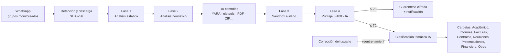
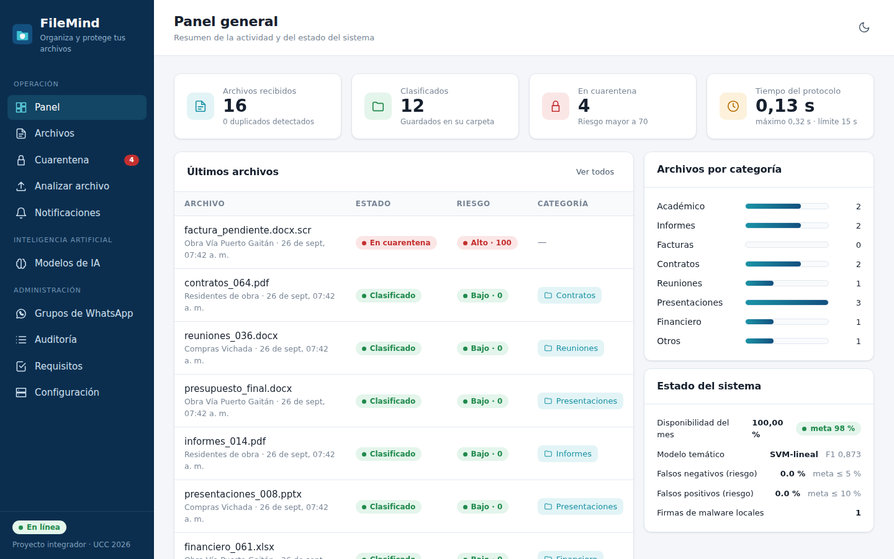
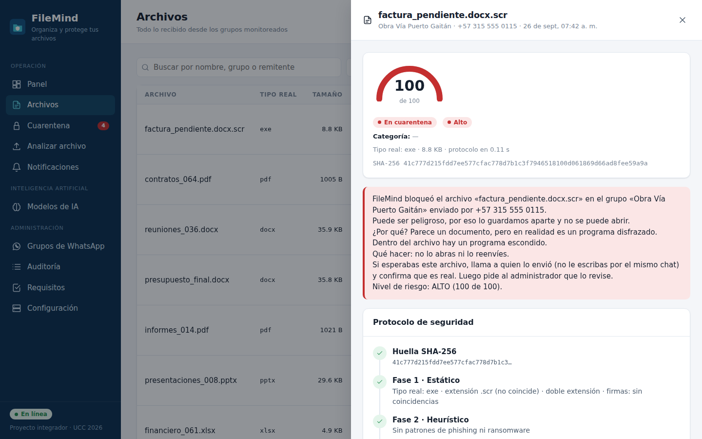
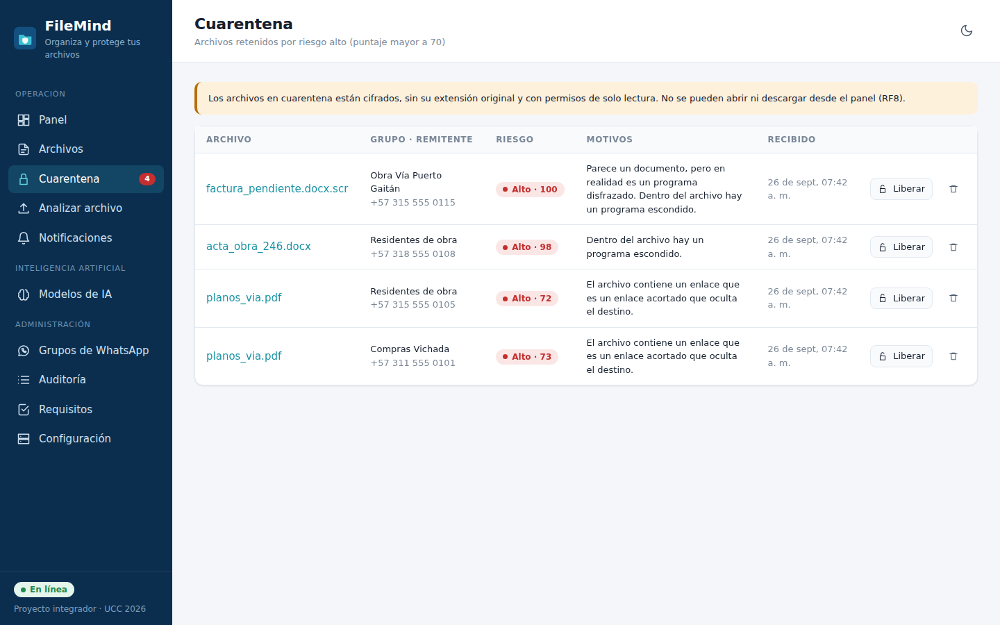
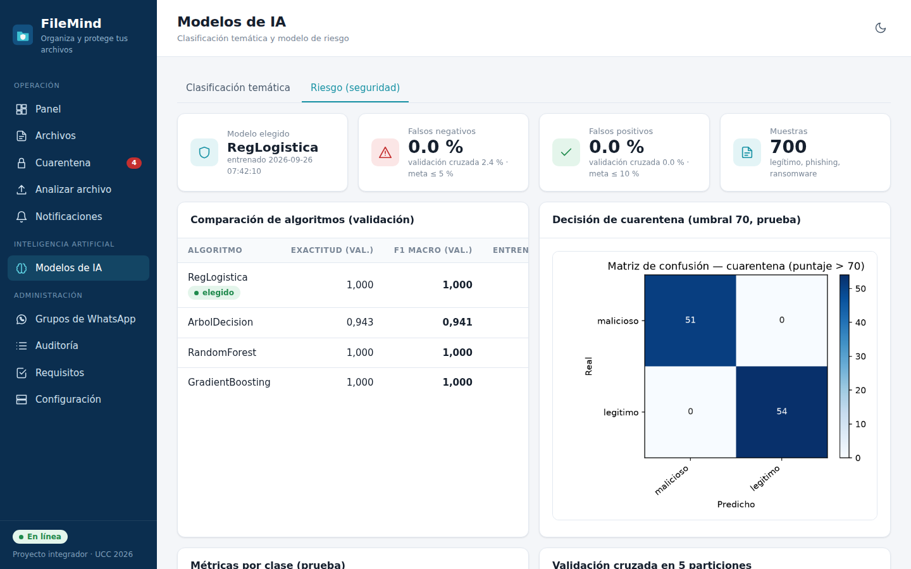

# FileMind

**Protocolo inteligente de verificación de seguridad y clasificación automática de archivos recibidos mediante WhatsApp.**

Proyecto integrador de *Inteligencia Artificial* y *Seguridad de la Información*
(Universidad Cooperativa de Colombia, Villavicencio, 2026) —
Nelson D. Quiroga M., Juan D. Vargas V., Miguel S. Colmenares R.

FileMind escucha solo los grupos de WhatsApp que el usuario elige, descarga cada
archivo compartido, lo somete a un **protocolo de seguridad de 4 fases** y, si es
seguro, lo **clasifica con IA** en una de 8 carpetas temáticas. Si es peligroso lo
deja **cifrado en cuarentena** y avisa al usuario en lenguaje claro.

Después de la Fase 2 corren **10 controles de ciberseguridad locales** (sin servicios de pago):
tipo real frente a la extensión y archivos políglotas, huellas MD5/SHA-1/SHA-256 contra listas de
malware (también de lo que el archivo trae adentro), macros VBA y Excel 4.0 y objetos OLE con
oletools, JavaScript, acciones automáticas y adjuntos en PDF, comprimidos anidados, con contraseña
o bombas, reglas YARA, entropía, enlaces ocultos, formularios HTML de credenciales y peticiones de
claves con enlace. La interfaz muestra qué encontró cada uno. Pesos y resultados en
[`docs/protocolo_riesgo.md`](docs/protocolo_riesgo.md).



## Interfaz

| Panel general | Detalle del protocolo |
|---|---|
|  |  |
| **Cuarentena** | **Modelos de IA** |
|  |  |

## Arquitectura

Tres aplicaciones, cada una en el lenguaje donde tiene mejores herramientas:

| Carpeta | Lenguaje | Qué hace |
|---|---|---|
| `backend/` | Python 3.10+ · FastAPI · scikit-learn | Protocolo de seguridad, modelos de IA, API REST, auditoría |
| `frontend/` | JavaScript · React 18 · Vite | Interfaz web (panel, cuarentena, modelos, requisitos…) |
| `whatsapp-gateway/` | JavaScript · Node.js · whatsapp-web.js | Escucha los grupos y envía los adjuntos a la API |

La IA y el análisis de seguridad van en Python porque las librerías clave
(scikit-learn, oletools, PyMuPDF, cryptography) son de Python. JavaScript se usa
donde es el estándar: la interfaz web y la conexión con WhatsApp Web.

El backend está organizado por capas; el detalle y los diagramas están en
[`docs/arquitectura.md`](docs/arquitectura.md).

```
backend/filemind/
├── domain/           Modelo del dominio: categorías, estados, niveles de riesgo
├── security/         Fases 1-4: static, signatures, heuristic, controls, sandbox, risk (+ muestras inertes)
│   └── reglas/       Reglas YARA (*.yar) que aplica el control «yara»
├── ai/               Clasificador temático, dataset y evaluación (métricas y gráficas)
├── infrastructure/   Repositorio de auditoría (SQLite + JSONL), almacenamiento y cuarentena
│                     cifrada, extracción de texto, notificaciones, disponibilidad, conector carpeta
├── services/         analysis_service.py: orquesta el protocolo completo
└── api/              FastAPI: app, dependencias, esquemas y un router por recurso
backend/sandbox/worker.py   Proceso que corre dentro del entorno aislado
backend/scripts/            entrenar.py · pruebas_rendimiento.py · evaluar_controles.py · actualizar_firmas.py
backend/tests/              Pruebas automáticas, una o más por requisito
backend/reportes/           Matrices de confusión, curvas PR y F1, métricas JSON
frontend/src/               api/ · components/ · hooks/ · pages/ · styles/ · utils/
docs/                       Trazabilidad, arquitectura, protocolo de riesgo, requerimientos y capturas
```

## Abrir en VS Code

1. **Archivo → Abrir carpeta…** y elegir `filemind`. Acepta instalar las
   extensiones recomendadas (Python, Pylance, Ruff, Prettier, REST Client, Mermaid).
2. **Terminal → Ejecutar tarea… → Instalar todo.** Crea el entorno `.venv`,
   instala Python y los paquetes de Node. VS Code detecta `.venv` solo; si pregunta,
   elígelo como intérprete.
3. **Terminal → Ejecutar tarea… → Entrenar modelos de IA** (≈ 1-2 min la primera vez).
4. En **Ejecutar y depurar** (Ctrl+Shift+D) elige **FileMind completo (API + interfaz)**
   y presiona **F5**. Se abre la interfaz en http://localhost:5173 con puntos de
   interrupción en Python y en React.

| Configuración de F5 | Para qué |
|---|---|
| Backend: API FastAPI | Solo la API en http://127.0.0.1:8000 (sirve también la interfaz compilada) |
| Interfaz: Vite (React) | Interfaz con recarga en caliente |
| Puente de WhatsApp | Conecta WhatsApp (muestra el QR en la terminal) |
| Pruebas de requisitos (pytest) | Corre y depura las pruebas; también aparecen en el panel *Testing* |
| Entrenar modelos de IA / Pruebas de rendimiento | Scripts de entrenamiento y medición |
| Analizar archivo abierto | Pasa el archivo del editor por el protocolo |

`docs/api.http` tiene ejemplos de cada punto de la API para probarlos con REST Client.

## Instalación por terminal

> **¿Vas a desplegarlo en un servidor?** Sigue [`DEPLOY.md`](DEPLOY.md) (Docker, HTTPS y WhatsApp).

Requisitos: Python 3.10+, Node.js 18+. Para el aislamiento de la Fase 3 (RNF5):
Linux con `unshare`, o Docker (Docker Desktop en Windows y macOS).

Arquitectura en tres piezas: **backend** FastAPI (`backend/`, Python), **interfaz** React + Vite
(`frontend/`, la sirve el mismo backend una vez compilada) y **puente de WhatsApp** en Node
(`whatsapp-gateway/`, whatsapp-web.js), que le pasa a la API los adjuntos de los chats escogidos.

```bash
# 1. Backend
python -m venv .venv && source .venv/bin/activate     # Windows: .venv\Scripts\activate
pip install -r backend/requirements.txt

# 2. Interfaz: compilarla una vez (frontend/dist no está en el repositorio)
cd frontend && npm install && npm run build && cd ..

# 3. Arrancar: API + interfaz en http://127.0.0.1:8000
cd backend
python -m filemind serve
```

Los modelos entrenados ya vienen en `backend/data/modelos/`, así que no hace falta entrenar
para usarlo. Para volver a entrenarlos: `python scripts/entrenar.py` (desde `backend/`).
Las variables de configuración están explicadas en [`.env.example`](.env.example).

**Primer administrador.** La primera vez que abras la página aparece «Crear administrador».
También se puede crear o restablecer una cuenta por terminal (desde `backend/`):

```bash
python -m filemind usuario admin "Nombre Apellido" --rol admin   # pide la contraseña
python -m filemind usuario ana "Ana Pérez"                        # cuenta de miembro
```

**Pruebas automáticas:**

```bash
cd backend && python -m pytest        # 61 pruebas: requisitos, API web y carpeta del bufete
cd whatsapp-gateway && npm test       # vigilante, reintentos y cola del puente
python scripts/evaluar_controles.py   # detección antes/después de los controles (desde backend/)
```

Para cambiar la interfaz con recarga en vivo:

```bash
cd frontend
npm install
npm run dev        # http://localhost:5173 (envía /api al backend)
npm run build      # vuelve a generar frontend/dist
```

Analizar archivos sin WhatsApp (útil para la sustentación):

```bash
cd backend
python -m filemind grupos "Compras Vichada" "Obra Vía Puerto Gaitán"
python -m filemind analizar factura.pdf --grupo "Compras Vichada"
python -m filemind vigilar ~/Descargas/WhatsApp --grupo "Compras Vichada"   # conector por carpeta
```

### Conectar WhatsApp

`python -m filemind serve` enciende el puente solo. También se enciende desde la página
**Chats de WhatsApp** con el botón «Encender WhatsApp», o a mano:

```bash
cd whatsapp-gateway
cp .env.example .env               # NOTIFY_TO = número que recibe las alertas
npm install
npm start
```

Para vincular el número entra a **Chats de WhatsApp**: aparece un código QR que se escanea en el
celular en WhatsApp → Dispositivos vinculados → Vincular un dispositivo. La sesión queda guardada en
`whatsapp-gateway/.wwebjs_auth/`. Para cambiar de número usa «Desvincular y usar otro número».

El puente consulta `/api/grupos` cada 30 s y **solo descarga** adjuntos de esos
grupos (RF1). Cada archivo se envía a `/api/ingest` con la hora del mensaje para
medir la latencia (RF2). Las alertas se reenvían por chat privado y, si el archivo
quedó en cuarentena, también se responde en el grupo.

### Exportar los archivos de un chat (RF9 a RF11)

En **Chats de WhatsApp** toca un grupo o chat y pulsa **Exportar archivos**. El
puente lee el historial de ese chat (hasta `EXPORT_LIMIT` mensajes, 1000 por
defecto), arma una cola visible y sube los adjuntos uno por uno. Cada archivo
pasa por la huella, las 4 fases y la clasificación antes del siguiente. Al
terminar, los seguros se descargan uno a uno o en un ZIP, o se guardan en una
carpeta del equipo con una subcarpeta por categoría. Los riesgosos se quedan en
la cuarentena cifrada y nunca se copian.

### Aplicación de escritorio (RF12)

Doble clic en `FileMind.bat` (o `python -m filemind escritorio` desde `backend/`).
Abre FileMind en una ventana propia con el motor Edge WebView2 de Windows y, por
dentro, arranca la API y el puente de WhatsApp si no estaban corriendo. Al cerrar
la ventana se detiene lo que ella misma arrancó. La versión web sigue igual en
`http://127.0.0.1:8000`. Requiere `pip install pywebview` (ya está en
`requirements.txt`). El registro del puente queda en `backend/data/puente_whatsapp.log`.

### Docker

`docker compose up -d --build` compila la interfaz, levanta la API (con
`restart: unless-stopped` y *healthcheck*, RNF2) y el puente con su propio Chromium. Con Docker, la
Fase 3 corre cada archivo en un contenedor desechable
`--network none --read-only --cap-drop ALL`. La guía completa para un servidor, con HTTPS y la
sesión de WhatsApp en un volumen, está en [`DEPLOY.md`](DEPLOY.md).

## Robustez y evaluación

- **Puente estable**: vigilante cada 60 s, reinicio con cliente nuevo y espera exponencial (5 s → 5 min),
  reintentos de descarga y cola en disco `.pendientes/` si la API está apagada (`whatsapp-gateway/lib.js`, `npm test`).
- **Importación incremental**: al volver a exportar un chat solo se descargan los adjuntos nuevos
  (por id de mensaje y por la huella SHA-256 que trae WhatsApp). Botón «Todo de nuevo» para reprocesar.
- **Métricas detalladas** en la pantalla Modelos: parámetros leídos del modelo, latencia p50/p95, F1 por clase,
  curva de aprendizaje, calibración (ECE), salud del modelo en uso y explicación de cada clasificación.
- **Benchmark** (`python scripts/benchmark.py`, MiniLM opcional con `sentence-transformers`): con 1.177 sentencias
  reales, FileMind F1 0,915 · Naive Bayes 0,893 · reglas 0,747 · zero-shot TF-IDF 0,567 · zero-shot MiniLM 0,483.

## Resultados

| Requisito | Meta | Resultado | Evidencia |
|---|---|---|---|
| RF4 extensiones falsas | ≥ 10 casos | 12/12 detectados | `backend/tests/test_requisitos.py::test_rf4_*` |
| RNF1 tiempo por archivo | ≤ 15 s (≤ 20 MB) | prom. 0,35 s · máx. 2,7 s (30 archivos) | `backend/reportes/rendimiento.json` |
| RF2 detección | ≤ 10 s | prom. 2,4 s · máx. 3,6 s (conector carpeta) | `backend/reportes/rendimiento.json` |
| RNF3 falsos negativos | ≤ 5 % | 0 % en prueba · 2,4 % en validación cruzada | `backend/reportes/riesgo_metricas.json` |
| RNF4 falsos positivos | ≤ 10 % | 0 % en prueba y en validación cruzada | `backend/reportes/riesgo_metricas.json` |
| RNF5 aislamiento | sin red ni escritura | red bloqueada, escritura bloqueada, directorio efímero (Docker o `unshare`) | `test_rnf5_*` |
| RNF6 10 grupos | degradación ≤ 20 % | sin degradación (−26 %) | `backend/reportes/rendimiento.json` |
| Clasificación temática | — | F1-macro 0,923 · exactitud 0,924 (SVM lineal, 118 sentencias reales de prueba) | `backend/reportes/tema_metricas.json` |

La pantalla **Requisitos** de la interfaz muestra estas mediciones en vivo. La matriz completa requisito → código → prueba está en
[`docs/trazabilidad.md`](docs/trazabilidad.md) y la fórmula del puntaje en
[`docs/protocolo_riesgo.md`](docs/protocolo_riesgo.md).

## Limitaciones

* Los datasets son **sintéticos** y las muestras maliciosas son **inertes**
  (reproducen indicadores, no contienen código funcional). Por eso las métricas del
  modelo de riesgo son muy altas; la prueba de "ataques no vistos"
  (`ataques_no_vistos` en `riesgo_metricas.json`) muestra el límite real: si el modelo nunca vio
  el phishing "sutil" (un solo enlace acortado y una frase de urgencia), no lo detecta (0 %). Las reglas de alta confianza
  compensan en la mayoría de los casos. El siguiente paso es añadir muestras reales
  (p. ej. de MalwareBazaar, en un equipo aislado) y documentos reales anonimizados en
  `backend/data/dataset_real/<Categoria>/`.
* No reemplaza un antivirus empresarial. El sandbox no ejecuta binarios: desempaqueta
  y decodifica el contenido en un entorno aislado.
* La consulta de firmas externas depende de APIs de terceros (MalwareBazaar,
  VirusTotal) y requiere clave.
* `whatsapp-web.js` es una librería no oficial y puede dejar de funcionar si WhatsApp
  cambia; por eso existe el conector alterno por carpeta.
* En Windows y macOS sin Docker no hay forma de cortar la red del proceso de análisis;
  el sistema funciona, pero la prueba de RNF5 se omite y lo indica. Con Docker Desktop
  se cumple igual que en Linux.
* OCR de imágenes opcional (requiere Tesseract).

## Perfiles de categorías

`backend/config.json` usa `"perfil": "constitucional"`: Tutela, Inconstitucionalidad, Tratados,
Decretos legislativos y Objeciones, entrenado con 1.177 sentencias reales de la Corte Constitucional.
Hay otros dos perfiles: `"juridico"` (Demandas, Contestaciones, Tutelas, Peticiones, Recursos,
Providencias, Poderes, Contratos, Conciliaciones, Pruebas, Honorarios) y `"general"`.
Lo que no alcanza la confianza mínima (`FILEMIND_TOPIC_MIN_CONFIDENCE`, 0,70 en el despliegue
del bufete) va a «Otros» para revisión.

- Entrenar: `python scripts/entrenar.py --solo tema` guarda `data/modelos/tema_<perfil>.joblib`.
- Documentos reales del bufete (anonimizados) en `backend/data/dataset_real/<Categoria>/` se mezclan al
  entrenar y mejoran el modelo. Las correcciones de categoría hechas en la interfaz también.
- WhatsApp: inicia el puente y abre **Chats de WhatsApp** en la interfaz para escanear el QR y escoger
  qué chats (grupos o privados) se analizan.