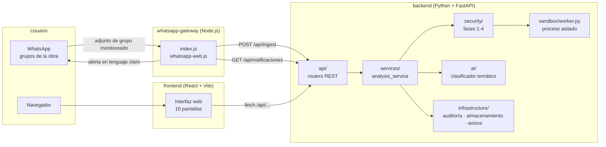
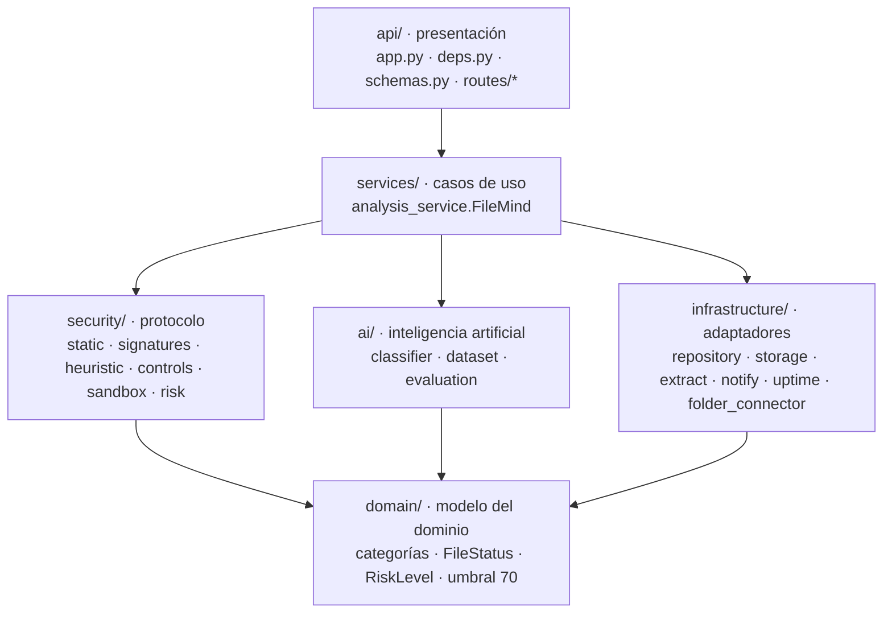
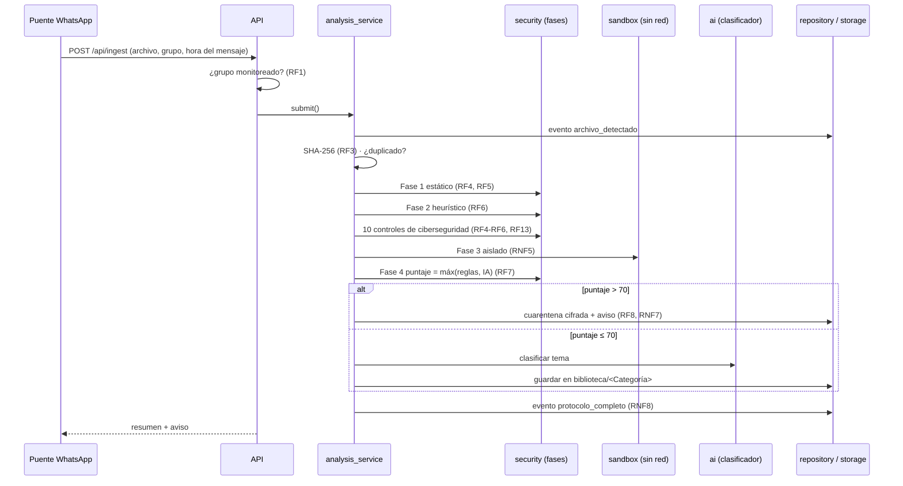

# Arquitectura de FileMind

## Vista general

La interfaz compilada (`frontend/dist`) la sirve la misma API, así que en
producción basta un proceso de Python más el puente de WhatsApp.

## Capas del backend

Las dependencias van en una sola dirección: de arriba hacia abajo.

| Capa | Responsabilidad | No debe |
|---|---|---|
| `domain` | Conceptos del negocio: 8 categorías, estados del archivo, niveles de riesgo, umbral de cuarentena | Importar nada del resto del sistema |
| `security` | Las 4 fases del protocolo; cada fase es una función pura que recibe bytes y devuelve hallazgos | Escribir en disco o en la base de datos |
| `ai` | Entrenar, evaluar y usar el clasificador temático | Conocer HTTP ni WhatsApp |
| `infrastructure` | Todo lo que toca el mundo exterior: SQLite, archivos, cifrado, webhooks, carpetas | Tomar decisiones de riesgo |
| `services` | Orquestar el flujo completo y garantizar el orden (SHA-256 primero, RF3) | Contener reglas de detección |
| `api` | Validar entradas (Pydantic), autorización por token y respuestas HTTP | Contener lógica de negocio |

## Flujo de un archivo

## API REST

| Método | Ruta | Uso |
|---|---|---|
| GET | `/health` | Estado del servicio (RNF2) |
| GET | `/api/disponibilidad` | Disponibilidad del mes |
| GET | `/api/estadisticas` | Conteos por estado y categoría, tiempos |
| GET | `/api/categorias` · `/api/configuracion` | Catálogo y parámetros activos |
| GET · PUT | `/api/grupos` | Grupos monitoreados (RF1) |
| POST | `/api/ingest` | Recibir un archivo (RF2) |
| GET | `/api/archivos` · `/api/archivos/{sha}` | Listado con filtros y detalle con eventos |
| GET | `/api/archivos/{sha}/descargar` | Descarga; 403 si está en cuarentena (RF8) |
| POST | `/api/archivos/{sha}/categoria` | Corrección del usuario (retroalimentación) |
| POST · DELETE | `/api/cuarentena/{sha}/liberar` · `/api/cuarentena/{sha}` | Liberar con motivo y confirmación, o eliminar |
| GET · POST | `/api/modelos` · `/api/reentrenar` | Métricas y reentrenamiento |
| GET | `/api/eventos` · `/api/auditoria/retencion` | Auditoría (RNF8) |
| GET | `/api/notificaciones` | Avisos pendientes para el puente (RNF7) |

La documentación interactiva está en http://127.0.0.1:8000/docs y hay ejemplos
listos en [`api.http`](api.http).

## Interfaz web

`frontend/src/` separa `api/` (cliente HTTP único), `hooks/` (`useApi` con
refresco periódico), `components/` (piezas reutilizables: tarjetas, medidor de
riesgo, cajón de detalle, modales) y `pages/` (una por pantalla). El tema
claro/oscuro se define con variables CSS en `styles/app.css`.
